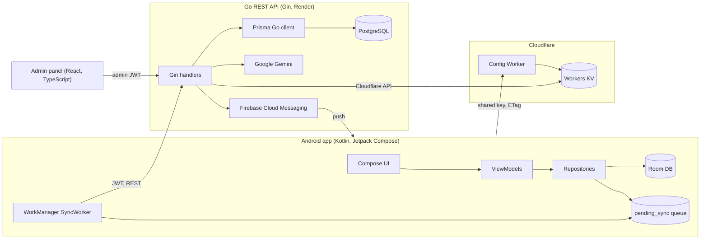

# Expent — Personal Finance Tracker

**Phase 1 · October 2026 · Solo, full-stack**

Expent is an offline-first personal finance app for Android. You log income and expenses by typing a
sentence ("Spent $25 on pizza yesterday using cash") and an LLM fills in the details. It tracks
recurring EMIs, loans and subscriptions and reminds you before they're due. It's built as three
projects: a native Android app, a Go REST API, and a React admin panel. A Cloudflare edge config
service lets UI text and the server address change without an app release.

---

## Architecture

---

## Features

### Android app
- **AI transaction entry.** The user types a natural-language sentence. The backend sends it to
  Google Gemini, which works out the amount, type, category, payment account and date, and the
  transaction is saved.
- **Manual transaction entry.** A bottom sheet with income/expense toggle, category and account
  pickers, and a date picker. It can also be opened from a **home-screen widget**.
- **Dashboard.**
  - Balance card with income and expense totals.
  - Recent transactions grouped by day.
  - A swipeable carousel of upcoming **reminders** (income, EMI and subscription due dates) that can
    be marked as paid in one tap.
- **Cashflow.** Recurring incomes, loans/EMIs (with repayment progress) and subscriptions, split into
  Incoming and Outgoing tabs with monthly totals.
- **Transaction history.** Search, income/expense and category filters, and daily net totals.
- **Guided onboarding.** Four steps: categories, payment accounts (pay now vs pay later), income, and
  recurring expenses.
- **Profile.**
  - Payment-mode and category managers, with duplicate checks and delete confirmation.
  - Reminder and AI-entry toggles.
  - In-app feedback with star rating.
- **Push notifications** via Firebase Cloud Messaging, including admin broadcasts.
- **Google Sign-In** using Android's Credential Manager.

### Offline-first data layer
- **Local first.** Every write goes to Room straight away, so the UI never waits on the network.
- **Sync queue.** Writes are also added to a `pending_sync` queue that a WorkManager worker sends to
  the API when the device is online.
- **No double sends.** All sync work runs through one unique WorkManager queue (`APPEND_OR_REPLACE`)
  guarded by a mutex, so queued items are never POSTed twice.
- **ID remapping.** Rows created offline use `local-*` IDs. When the server confirms them, the IDs are
  swapped for server IDs, and dependent rows such as budgets and expenses are updated.
- **Partial failures.** If the server accepted a request but the local update failed, the item is not
  resent. Failing items are retried up to five times.
- **Feedback.** Feedback goes through the same queue with no table of its own: it's sent when online
  and is acceptable to lose.

### Remote config (no-release UI changes)
- **What it holds:** all of the app's 400+ text strings and its API server URL, in one JSON document
  served by a **Cloudflare Worker** from **Workers KV**.
- **On the app side:**
  - The config is cached in **EncryptedSharedPreferences**.
  - It's refreshed on launch, on reconnect, and during the 15-minute background sync.
  - It uses **ETag / 304** responses, so an unchanged config costs no download.
  - The bundled default file is used only if the very first launch is offline.
- **Live updates:** text is read through a small `AppText` lookup backed by Compose snapshot state,
  so open screens re-render as soon as a new config arrives. An OkHttp interceptor sends every API
  call to the latest server URL.
- **Access:** the worker requires a shared key header and rejects all writes.

### Admin panel
- **Notifications:** broadcast a push notification to every registered device.
- **App config editor:**
  - Searchable form for every text, with placeholder-aware warnings: it flags when an edit drops a
    `{count}`-style value the app fills in.
  - A raw JSON mode.
  - A review screen showing each change before it goes live.
  - Drafts saved across page switches.
- **Safe publishing:**
  - The backend validates the config.
  - It rejects concurrent edits using version hashes, so two admins can't silently overwrite each
    other.
  - It backs up the previous version before writing to KV.

### Backend API
- **REST resources** for accounts, categories, transactions, budgets, EMIs/subscriptions, dashboard
  aggregates, user customization, device tokens and feedback.
- **Auth:** Google ID-token verification, JWT access and refresh tokens, and a separate admin role
  checked by middleware.
- **AI parsing:** an LLM endpoint (Gemini) that turns free text into a structured transaction.
- **Push:** FCM broadcast with automatic cleanup of stale device tokens.

---

## Tech stack

| Layer | Technologies |
|---|---|
| **Android** | Kotlin, Jetpack Compose, Material 3, MVVM + clean architecture (use cases, repositories), Hilt, Coroutines/Flow, Room, WorkManager, Retrofit + OkHttp, Gson, EncryptedSharedPreferences, Credential Manager (Google Sign-In), Lottie, App Widgets (RemoteViews) |
| **Firebase** | Cloud Messaging, Crashlytics, Analytics |
| **Backend** | Go, Gin, Prisma Client Go, PostgreSQL, JWT (golang-jwt), Firebase Admin SDK, Google Gen AI SDK (Gemini), zap logging |
| **Admin panel** | React 18, TypeScript, Vite, Tailwind CSS, React Router, React Hook Form + Zod, Axios |
| **Edge / infra** | Cloudflare Workers, Workers KV, Wrangler, Render |
| **Tooling** | Postman collections, Gradle version catalogs, product flavors (dev/prod) |

---

## Engineering highlights

- **Offline-first sync engine.** Room is the source of truth, with a durable operation queue
  (`pending_sync`), mapping from local IDs to server IDs, and duplicate-safe background sync through
  WorkManager.
- **Server-driven UI text and API routing.** I designed the config schema, moved 400+ hardcoded
  strings across every screen into lookups with built-in fallbacks, and built a checker script that
  verifies every key and fallback matches the config. Text updates appear in open screens immediately.
- **Edge-delivered config.** A Cloudflare Worker serves the config from KV with ETag/304, a
  shared-key check, and a rollout mode for older app versions. A rolling migration moved it off a
  static-asset worker without downtime.
- **Safe admin publishing.** Server-side schema validation, conflict detection using content
  hashes, automatic backups, and a review screen showing every change before publishing.
- **LLM-powered input.** Natural-language transaction capture using Google Gemini.
- **Production debugging.** I found an app-startup race between two config fetches (a 304 response
  was mistaken for "offline") from device logcat, and fixed it with explicit tracking of where the
  current config came from.

---

## Resume bullets

- Built **Expent**, an offline-first personal finance app (Kotlin, Jetpack Compose, Room, WorkManager,
  Hilt), with a Go/Gin + PostgreSQL REST API and a React/TypeScript admin panel, as the sole developer.
- Designed a **durable sync queue** with local-to-server ID remapping and duplicate-safe background
  sync, so every feature works without a connection.
- Added **natural-language transaction entry** using Google Gemini: the user types a sentence and gets
  a categorized transaction.
- Built a **server-driven config system** on Cloudflare Workers + KV with ETag caching and an
  encrypted local cache. It controls 400+ UI strings and the API server address without app releases.
- Built an **admin console** for push broadcasts and live config editing, with schema validation,
  conflict detection using content hashes, change review, and automatic backups.

---

## LinkedIn post (draft)

> Phase 1 of **Expent** is done 🎉
>
> Expent is a personal finance app I've been building end to end: Android app, backend, admin panel
> and edge services.
>
> A few things I'm proud of:
> 💬 **Type it, don't fill a form.** "Spent $25 on pizza yesterday using cash" becomes a
> categorized transaction, powered by Gemini.
> 📴 **Offline-first.** Everything saves locally and syncs in the background through a durable queue.
> ⚡ **Change the app without shipping it.** All 400+ UI texts and the API address come from a
> Cloudflare Worker + KV config that I can edit live from an admin panel.
> 🔔 Reminders for EMIs, subscriptions and salary days, plus push notifications.
>
> **Stack:** Kotlin · Jetpack Compose · Room · WorkManager · Hilt · Go · Gin · PostgreSQL · Prisma ·
> React · TypeScript · Tailwind · Cloudflare Workers/KV · Firebase · Gemini
>
> Next up: spending analytics and a Play Store launch.
>
> #AndroidDev #Kotlin #JetpackCompose #Golang #React #Cloudflare #FullStack

---

## Roadmap (Phase 2)

- Spending analysis screen (the screen exists; charts are still to build).
- Multi-currency support (amounts currently display in `$`).
- Account deletion and data export.
- Play Store release.
